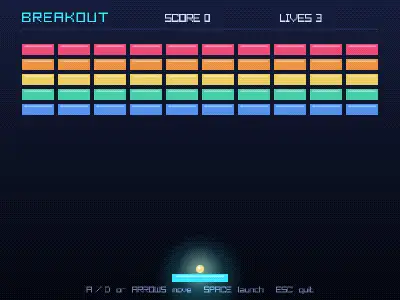
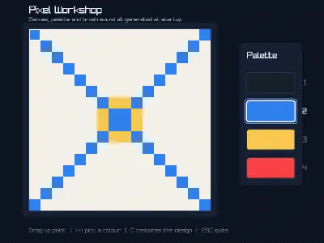
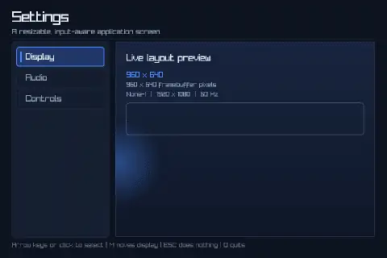
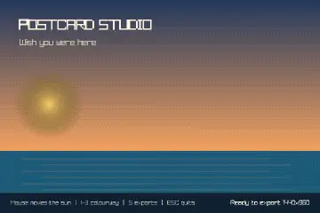
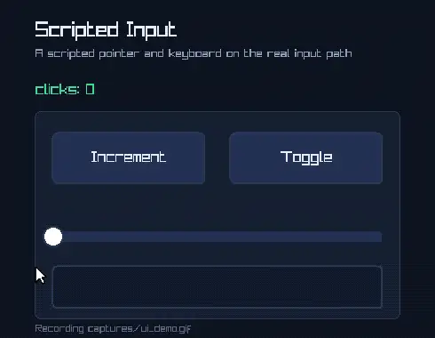
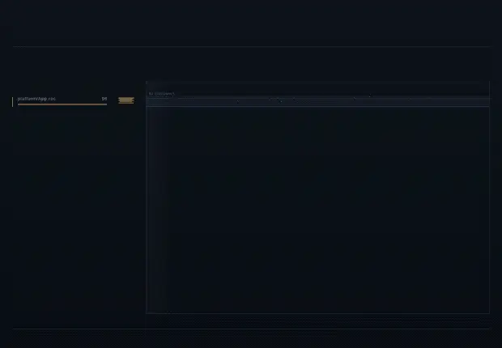
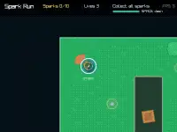
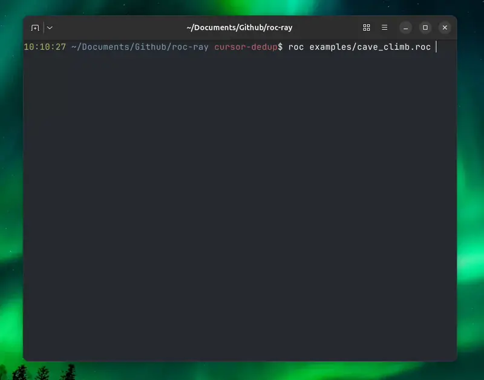

# RocRay

Make 2D games, visual tools, and interactive apps in
[Roc](https://www.roc-lang.org/), powered by
[raylib](https://www.raylib.com/).

RocRay is for smaller graphical programs, such as games, visualizations, and
interactive tools. It is not meant to compete with large, purpose-built game
engines: it has no editor, scene graph, physics engine, or asset pipeline.
Your app keeps its own state and makes every decision itself; RocRay provides
drawing, sound, keyboard, mouse and gamepad input, the window, recording,
files, and networking. It runs on macOS (Intel and Apple silicon), Linux
x86-64, and Windows x86-64.

RocRay draws in 2D today. 3D models, cameras, and lighting are planned but not
yet available. RocRay is not a GUI toolkit: for desktop applications built
from widgets such as buttons, text fields, and layouts, see
[roc-gui](https://github.com/lukewilliamboswell/roc-gui).

Start with [Hello World](examples/hello_world/main.roc),
[Pong](examples/pong/main.roc), and [Snake](examples/snake/main.roc). These
larger examples show what else it can do:

<table>
  <tr>
    <td align="center"><a href="examples/breakout/main.roc"><br><strong>Breakout</strong></a><br>Arcade gameplay, sounds made in code, recording</td>
    <td align="center"><a href="examples/generated_assets/main.roc"><br><strong>Pixel Workshop</strong></a><br>Drawing pixels and creating sounds in code</td>
    <td align="center"><a href="examples/responsive_ui/main.roc"><br><strong>Responsive Settings</strong></a><br>Keyboard, mouse, resizing, display scaling</td>
  </tr>
  <tr>
    <td align="center"><a href="examples/postcard_studio/main.roc"><br><strong>Postcard Studio</strong></a><br>Generative art and saving larger images</td>
    <td align="center"><a href="examples/particles/main.roc"><br><strong>Particles</strong></a><br>Thousands of moving images at once</td>
    <td align="center"><a href="examples/capture_ui_demo/main.roc"><br><strong>Capture UI Demo</strong></a><br>Automated controls and GIF recording</td>
  </tr>
  <tr>
    <td align="center"><a href="examples/live_plot/main.roc"><br><strong>Live Plot</strong></a><br>Loading and drawing hundreds of thousands of lines</td>
    <td align="center"><a href="examples/top_down/main.roc"><br><strong>Spark Run</strong></a><br>Designed map, characters, music, game states</td>
    <td align="center"><a href="examples/cave_climb/main.roc"><br><strong>Cave Climb</strong></a><br>Designed level, jumping, camera</td>
  </tr>
</table>

## Try it

1. Install the latest nightly build of the Roc compiler, as
   [Getting started](docs/getting-started.adoc#install) describes.
2. Open the [latest release](https://github.com/lukewilliamboswell/roc-ray/releases/latest),
   download its `roc-ray-examples-<version>.zip` and unzip it.
3. Open a terminal in the extracted `roc-ray-examples-<version>` directory,
   and run:

```bash
roc version
roc examples/hello_world/main.roc
```

## Documentation

Follow [the manual](https://lukewilliamboswell.github.io/roc-ray/) to write your
first app and learn the app model, input, drawing, tasks and permissions. See the
[API reference](https://lukewilliamboswell.github.io/roc-ray/api/) for exact
interfaces, [Contributing](CONTRIBUTING.md) to change RocRay, and
[GitHub Releases](https://github.com/lukewilliamboswell/roc-ray/releases) for
version-specific changes and downloads.

## Licence

RocRay is released under the Universal Permissive License v1.0; see
[`LICENSE`](LICENSE). That grant covers this project's own code and data.
Vendored libraries and example asset packs keep their own licences and
copyright holders, all indexed in
[`THIRD-PARTY-LICENCES.md`](THIRD-PARTY-LICENCES.md).

RocRay follows the latest nightly build of the Roc compiler, and names no
compiler of its own. Because Roc is still changing, RocRay's API may also
change. Bug reports, documentation improvements, and focused new
capabilities are welcome.
