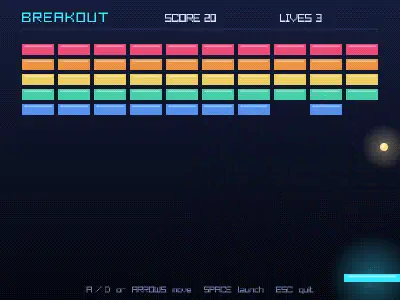
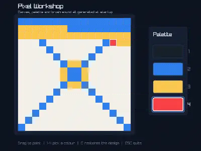
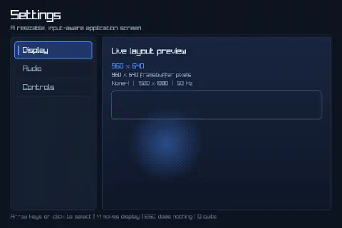
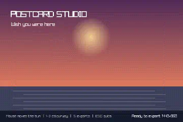
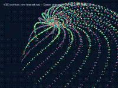
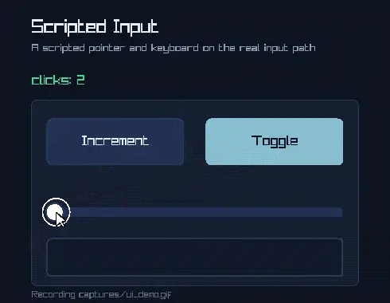
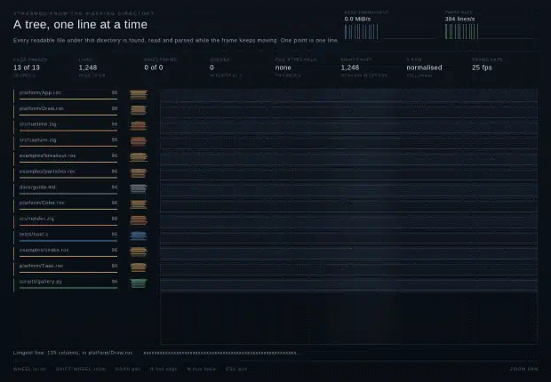
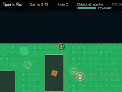
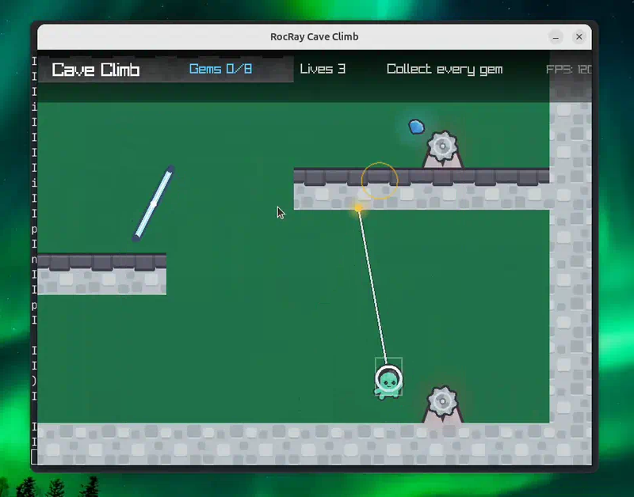

[#overview]
= What RocRay is

RocRay lets you write 2D games, visualizations, creative tools, and other
interactive programs in https://www.roc-lang.org/[Roc]. It draws with
https://www.raylib.com/[raylib], a popular C library for games, and runs on
macOS (Intel and Apple silicon), Linux x86-64, and Windows x86-64.

It suits programs that draw a fresh picture many times a second: arcade and
puzzle games, simulations, live plots, generative art, and small editors.

RocRay draws in 2D today: shapes, images, and text, with 2D cameras, shaders,
and offscreen drawing. 3D models, cameras, and lighting are planned but not
yet available.

RocRay is for smaller graphical programs, such as games, visualizations, and
interactive tools. It is not meant to compete with large, purpose-built game
engines: it has no editor, scene graph, entity system, physics engine, or
asset pipeline. Your app keeps its own state and makes every decision itself.
RocRay provides drawing, sound, keyboard, mouse and gamepad input, the window,
screen recording, files, and networking. If your app needs a scene graph or
an entity system, build it in Roc or use a package.

RocRay is also not a GUI toolkit. For desktop applications built from widgets
such as buttons, text fields, and layouts, see
https://github.com/lukewilliamboswell/roc-gui[roc-gui].

If you already know raylib, xref:coming-from-raylib.adoc#coming-from-raylib[Coming from raylib] shows how its functions and
habits map onto RocRay.

== What you write

A RocRay app is three functions:

* `init!` runs once, at startup. It chooses the window's settings, loads what
  the app needs, and creates the starting state, which RocRay calls the
  _model_.
* `update!` receives the model and what just happened: which keys were
  pressed, how the mouse moved, and which tasks finished. It returns the next
  model.
* `render!` draws the model.

The _host_, the native program that runs your app, calls them in a loop. One
pass around that loop is a _host cycle_: the host gathers what happened, calls
`update!` once, and then calls `render!` to draw the result. Each picture
`render!` draws is a _frame_. Normally every host cycle draws one frame, so a
game running at 60 frames a second also runs 60 host cycles a second. The two
differ only when the host skips drawing, for example while the window is
minimized.

Reading a file or waiting for a network reply can take longer than one host
cycle. Slow operations like these run as a _task_, so the app keeps updating
and drawing while it waits. When the task finishes, its result arrives in a later `update!`.

xref:app-model.adoc#app-model[The app model: init!, update!, and render!] explains these pieces in full. You do not need them to run your
first example. xref:glossary.adoc#glossary[Glossary] defines every term the manual uses.

== What an app can access

Every app can draw, read input, play sound, print to its terminal, and record
itself. Anything more, such as a network service, a directory, another
program, an environment variable, or the clipboard, must be declared in the
app's startup settings. So you can see what an app can access by reading its
source.
xref:permissions.adoc#permissions[Permissions: what your app can access] explains how.

== What it looks like

Three short examples are the best place to start:
https://github.com/lukewilliamboswell/roc-ray/blob/main/examples/hello_world/main.roc[Hello World], a circle that follows the
mouse; https://github.com/lukewilliamboswell/roc-ray/blob/main/examples/pong/main.roc[Pong], a complete game in one file; and
https://github.com/lukewilliamboswell/roc-ray/blob/main/examples/snake/main.roc[Snake], a grid game you can restart.

These larger apps are also in the repository's `examples/` directory, roughly
from simplest to most involved. Each links to its complete Roc source.

// Each picture is a still from the app's recording in examples/gallery/,
// which the README shows. scripts/prepare_docs_images.py makes the stills.

https://github.com/lukewilliamboswell/roc-ray/blob/main/examples/breakout/main.roc[*Breakout*]: arcade gameplay, sounds made in code, recording. https://github.com/lukewilliamboswell/roc-ray/blob/main/examples/gallery/breakout.webp[Watch the recording].

https://github.com/lukewilliamboswell/roc-ray/blob/main/examples/generated_assets/main.roc[*Pixel Workshop*]: drawing pixels and creating sounds in code. https://github.com/lukewilliamboswell/roc-ray/blob/main/examples/gallery/generated_assets.webp[Watch the recording].

https://github.com/lukewilliamboswell/roc-ray/blob/main/examples/responsive_ui/main.roc[*Responsive Settings*]: keyboard, mouse, resizing, display scaling. https://github.com/lukewilliamboswell/roc-ray/blob/main/examples/gallery/responsive_ui.webp[Watch the recording].

https://github.com/lukewilliamboswell/roc-ray/blob/main/examples/postcard_studio/main.roc[*Postcard Studio*]: generative art and saving larger images. https://github.com/lukewilliamboswell/roc-ray/blob/main/examples/gallery/postcard_studio.webp[Watch the recording].

https://github.com/lukewilliamboswell/roc-ray/blob/main/examples/particles/main.roc[*Particles*]: thousands of moving images at once. https://github.com/lukewilliamboswell/roc-ray/blob/main/examples/gallery/particles.webp[Watch the recording].

https://github.com/lukewilliamboswell/roc-ray/blob/main/examples/capture_ui_demo/main.roc[*Capture UI Demo*]: automated controls and GIF recording. https://github.com/lukewilliamboswell/roc-ray/blob/main/examples/gallery/capture_ui_demo.webp[Watch the recording].

https://github.com/lukewilliamboswell/roc-ray/blob/main/examples/live_plot/main.roc[*Live Plot*]: loading and drawing hundreds of thousands of lines. https://github.com/lukewilliamboswell/roc-ray/blob/main/examples/gallery/live_plot.webp[Watch the recording].

https://github.com/lukewilliamboswell/roc-ray/blob/main/examples/top_down/main.roc[*Spark Run*]: a designed map, characters, music, game states. https://github.com/lukewilliamboswell/roc-ray/blob/main/examples/gallery/top_down.webp[Watch the recording].

https://github.com/lukewilliamboswell/roc-ray/blob/main/examples/cave_climb/main.roc[*Cave Climb*]: a designed level, jumping, camera, sound. https://github.com/lukewilliamboswell/roc-ray/blob/main/examples/gallery/cave_climb.webp[Watch the recording].

An app can also record itself to a video file, such as this
https://github.com/lukewilliamboswell/roc-ray/blob/main/examples/gallery/capture_plot.webm[WebM plot recording].

== Stability

RocRay follows the latest nightly build of the Roc compiler: neither the
platform nor its examples name a compiler, and they are tested with the latest
nightly every day. Because Roc is still changing, RocRay's API may also change.
Each RocRay release's notes name the nightly it was built and tested with. Bug reports, documentation
improvements, and focused new capabilities are welcome; see xref:contributing.adoc#contributing[Contributing to RocRay].
